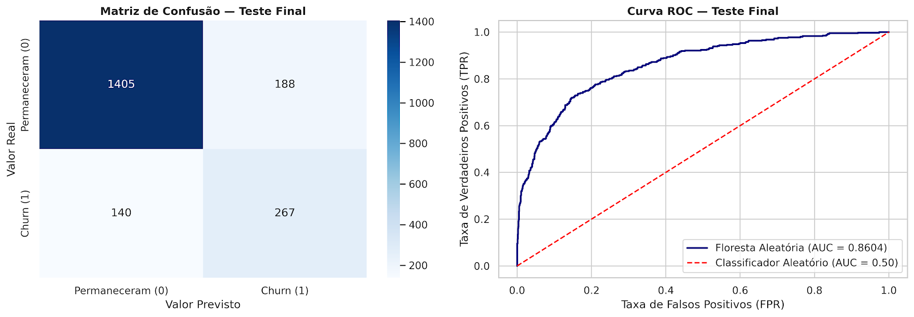

# 📌 Previsão de Churn de Clientes — Beta Bank


## 1. Apresentação e Contexto
O **Beta Bank** vem enfrentando a perda gradual de seus clientes mês a mês. Estudos de mercado no setor bancário demonstram que a retenção de clientes ativos é significativamente mais barata e rentável do que a aquisição de novos clientes (redução do CAC — Custo de Aquisição de Clientes). 

Este projeto desenvolve uma solução preditiva de **Aprendizado de Máquina Supervisionado (Classificação Binária)** capaz de sinalizar antecipadamente quais clientes têm alta probabilidade de encerrar suas contas na instituição, viabilizando estratégias preventivas e direcionadas de retenção.

---

## 2. Descrição do Problema de Negócio
A rotatividade de clientes (*churn*) impacta diretamente o faturamento, a margem operacional e a sustentabilidade financeira do banco. Para mitigar o problema de forma proativa, a equipe de CRM precisa identificar os perfis com maior risco de saída antes do cancelamento efetivo.

* **Desafio Técnico:** A base histórica apresenta um **desequilíbrio expressivo de classes** na proporção de **4:1** (~79,6% de clientes mantidos vs. ~20,4% de clientes em churn). Um classificador ingênuo que preveja apenas a permanência atingiria quase 80% de acurácia, mas falharia completamente no objetivo de negócio.
* **Solução:** Implementação de pipeline rigoroso sem vazamento de dados (*data leakage*), comparação de três técnicas de tratamento de desequilíbrio e otimização de hiperparâmetros focada na maximização do **$F_1$-score**.

---

## 3. Objetivo
* **Objetivo de Negócio:** Prever com precisão se um cliente deixará o banco em breve, permitindo campanhas preventivas de fidelização.
* **Objetivo Técnico:** Construir e validar algoritmos de classificação atingindo **$F_1$-score $\ge 0.59$** no conjunto de teste final.
* **Métricas Complementares:** Avaliar a curva ROC e calcular a métrica **AUC-ROC** para mensurar o poder discriminatório do modelo.

---

## 4. Tecnologias Utilizadas
* **Linguagem:** Python 3.x
* **Análise e Manipulação de Dados:** Pandas, NumPy
* **Visualização de Dados:** Matplotlib, Seaborn
* **Machine Learning & Pré-processamento:** Scikit-learn (`StandardScaler`, `train_test_split`, `DecisionTreeClassifier`, `RandomForestClassifier`, `LogisticRegression`, `roc_auc_score`, `f1_score`, `classification_report`, `confusion_matrix`)
* **Técnicas de Balanceamento de Classe:** Ponderação de Pesos (`class_weight='balanced'`), Sobreamostragem (*Upsampling*) e Subamostragem (*Downsampling*)
* **Ambiente de Desenvolvimento:** Jupyter Notebook / VS Code

---

## 5. Metodologia e Estrutura do Projeto

1. **Preparação e Engenharia de Dados:**
   * Remoção de identificadores únicos sem valor preditivo (`RowNumber`, `CustomerId`, `Surname`).
   * Codificação de variáveis categóricas (`Geography`, `Gender`) via *One-Hot Encoding* (`drop_first=True`).
   * Divisão estratificada (`stratify=y`) em **60% Treino / 20% Validação / 20% Teste**.
   * Imputação dos 909 valores nulos de `Tenure` utilizando a **mediana exclusiva do conjunto de treino** (5,0 anos) e padronização numérica via `StandardScaler` ajustado estritamente no treino.
2. **Modelagem Baseline (Sem Balanceamento):**
   * Avaliação de Regressão Logística, Árvore de Decisão e Floresta Aleatória sem tratamento de classes, evidenciando o viés em favor da classe majoritária ($F_1$ máximo de `0.5705`).
3. **Tratamento do Desequilíbrio de Classes:**
   * Comparação sistemática entre `class_weight='balanced'`, *Upsampling* (fator 4x) e *Downsampling* (fração 0.25).
4. **Otimização e Avaliação Final:**
   * Busca em grade (*Grid Search*) para ajuste de `max_depth` e `n_estimators` na Floresta Aleatória, seguida de validação final em dados virgens (Teste).

---

## 6. Principais Resultados e Visualizações

| Modelo / Cenário | $F_1$-score | AUC-ROC | Recall (Churn) | Precisão (Churn) |
| :--- | :---: | :---: | :---: | :---: |
| **Floresta Aleatória Baseline** *(Validação)* | 0.5705 | 0.8704 | - | - |
| **Floresta Aleatória Otimizada (`Teste Final`)** | **0.6269** | **0.8598** | **67%** | **59%** |

### 📊 Desempenho no Conjunto de Teste (Matriz de Confusão e Curva ROC)



* **Análise da Matriz de Confusão (2.000 clientes no teste):**
  * **Verdadeiros Positivos (273):** Clientes em risco real de saída que foram corretamente detectados pelo modelo (**Recall de 67%**).
  * **Verdadeiros Negativos (1.402):** Clientes fiéis corretamente classificados como retidos.
  * **Falsos Negativos (134) e Falsos Positivos (191):** Equilíbrio otimizado que garantiu um **$F_1$-score de 0.6269** (superando a meta mínima de `0.59`).
* **Curva ROC (AUC = 0.8598):** O distanciamento expressivo da curva azul em relação à linha tracejada (classificador aleatório) comprova o forte poder discriminatório do modelo.

---

## 7. Impacto de Negócio
* **Mitigação Proativa de Evasão:** Com um **recall de 67%**, a solução identifica aproximadamente 2 a cada 3 clientes com intenção real de encerrar suas contas antes que o cancelamento ocorra.
* **Eficiência no Orçamento de Retenção:** Com **59% de precisão**, a equipe de CRM direciona incentivos, isenções de tarifas e atendimento personalizado com alta assertividade, evitando descontos desnecessários para clientes que já permaneceriam no banco.
* **Aumento do LTV (*Lifetime Value*):** A retenção antecipada estende o ciclo de vida dos correntistas, protegendo a receita recorrente da instituição.

---

## 8. Estrutura do Repositório

```text
Analise_de_Evasao_Beta_Bank/
├── datasets/Churn.csv               # Conjunto de dados utilizado
├── notebook.ipynb                   # Notebook completo com análise, modelagem e gráficos
├── matriz_confusao_curva_roc.png    # Visualização das métricas finais de avaliação
└── README.md                        # Documentação executiva do projeto
```

---

## 9. Como Executar o Projeto

```bash
# 1. Clone este repositório
git clone [https://github.com/derikpetiz/Analise_de_Evasao_Beta_Bank.git](https://github.com/derikpetiz/Analise_de_Evasao_Beta_Bank.git)

# 2. Acesse a pasta do projeto
cd Analise_de_Evasao_Beta_Bank

# 3. Instale as dependências necessárias
pip install pandas numpy matplotlib seaborn scikit-learn jupyter

# 4. Inicie o Jupyter Notebook
jupyter notebook
```

---

## 10. Autor
**Derik Petiz**  
* MBA em Data Science & Artificial Intelligence — TripleTen  
* GitHub: [github.com/derikpetiz](https://github.com/derikpetiz)
